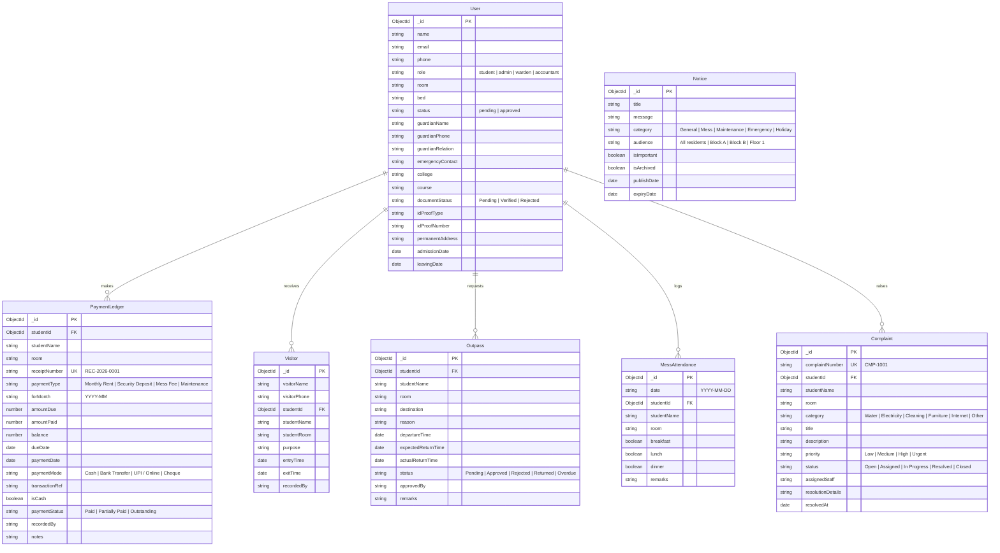

# Traditional Hostel Management System Enhancement
## Digital Transformation of Indian Hostel & PG Operations

---

## 1. Feature Audit & Gap Analysis

| Feature Area | Current Status | Required Enhancement | Target Model(s) |
|---|---|---|---|
| **1. Student Admission Register** | Basic credentials (name, email, room, bed, status) | Complete admission ledger: Guardian details, emergency contacts, college info, document verification (`Pending`, `Verified`, `Rejected`), admission/leaving dates, search, and printable register with manual signature blocks. | `User` (extended) |
| **2. Rent & Payment Ledger** | Basic payment summary without ledger accounts | Double-entry style traditional ledger: Unique receipt numbers (`REC-YYYY-XXXX`), security deposit vs monthly rent, fee due dates, payment modes (`Cash`, `Bank Transfer`, `UPI / Online`, `Cheque`), verified bank vs manual cash flags, outstanding balances, receipt printout. | `PaymentLedger` (new / extended) |
| **3. Visitor & Outpass Register** | Client-side mock log only | Formal physical-style visitor book (name, phone, student, room, in/out timestamps, purpose) and student outpass requests (reason, destination, departure, expected return, warden approval, overdue tracking). | `Visitor` & `Outpass` (new) |
| **4. Mess & Meal Register** | Static menu card | Daily meal attendance register (Breakfast, Lunch, Dinner), weekly meal timetable planner, meal counts, mess complaints, and monthly mess attendance sheet. | `MessAttendance` & `MessMenu` (new) |
| **5. Complaint & Maintenance Register** | Mock cards in dashboard | Traditional maintenance register with sequential serial IDs (`CMP-1001`), categories (Water, Electricity, Internet, Cleaning, Furniture, Other), priority, assigned staff, status tracking (`Open` -> `Assigned` -> `In Progress` -> `Resolved`), completion dates. | `Complaint` (new) |
| **6. Digital Notice Board** | Title & message only | Formal circular board with category tagging, urgency flag (`isImportant`), validity dates (`publishDate`, `expiryDate`), automated archiving (preserves audit records without deletion), printable circular format. | `Notice` (extended) |
| **7. Traditional Register Printing & Exports** | Browser default print | Dedicated `@media print` styling: Official hostel letterhead, tabular registers, printable payment receipts, CSV data exports, and mandatory physical verification signature blocks (*Warden*, *Accountant*, *Hostel Owner*). | CSS print system & CSV utilities |

---

## 2. Database Schema Architecture

